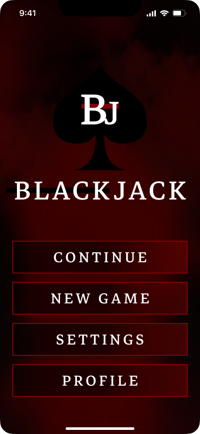
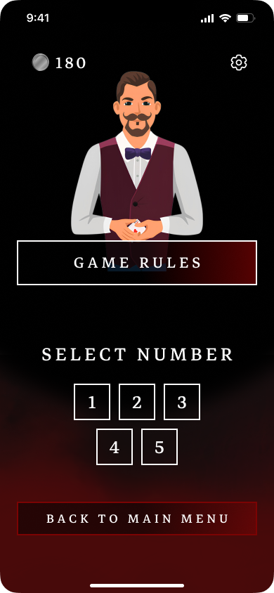
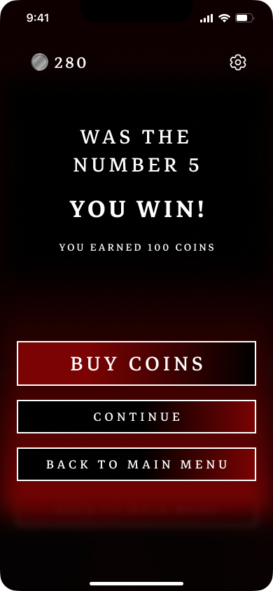
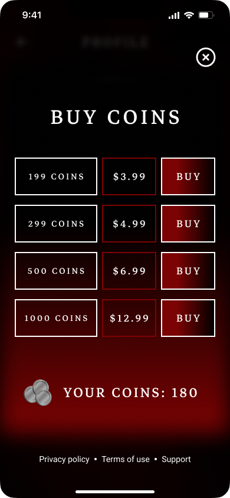

# Blackjack Mobile Game UI

UX/UI case study for a mobile mini-game inspired by Blackjack, built around number-guessing, monetization, and a simple but engaging casino-style flow.

## Scope

This is a Figma interface concept with screen exports, not an implemented or released game. Purchase screens are visual proposals; there is no payment integration or measured business result.

## Overview

This project explores the interface design for a mobile casual game that borrows the emotional feel of Blackjack without relying on classic card rules. The goal was to make the game accessible to a wide audience, including players who are not familiar with traditional card games.

The full UI was designed manually in Figma as a compact gameplay experience focused on fast entry, clear actions, and strong visual atmosphere.

## Project Goal

Design a mobile game interface that:

- lets the player start in 2-3 taps
- keeps the main flow centered around "Continue / New Game"
- communicates win / lose states clearly
- introduces monetization without aggressive interruptions
- preserves a casino mood while using a simplified number-based mechanic

## Target Audience

- Age: 16-35
- Mobile players looking for quick game sessions
- Users who prefer intuitive interfaces over long onboarding
- Players attracted by casino aesthetics, clear feedback, and smooth transitions

## UX Approach

- The main user path is intentionally short and low-friction
- Actions are designed for one-handed mobile interaction
- Limits and failure states do not hard-block the player and instead offer soft recovery options
- Victory and defeat are shown as short, readable feedback screens with a next step
- The visual center of the product is the main action flow rather than secondary menus

## Screen Structure

### Main Screen and Menu

- Blackjack logo placed in the center
- Primary actions:
  - Continue
  - New Game
  - Settings
  - Profile
- First launch includes a loading screen with a progress bar

### Difficulty Selection

- Three options:
  - God of Luck
  - Lucky
  - Not Lucky
- Naming and color coding help explain the difficulty without extra text

### Gameplay Screens

- Dealer character as the visual anchor
- Clear prompt: "Select number"
- Number buttons from 1 to 5 on the current sample level, with room to scale later
- Animated transition into win / lose result states
- Reward growth after successful progress
- Option to return to menu or buy coins after defeat

### Buy Coins Screen

- Simple package selection layout
- Clear purchase hierarchy with strong button visibility
- Balance and back action remain easy to find
- App Store integration is represented visually in the concept

### Supporting Screens

- Settings
- Game Rules
- Restriction / not enough coins screen
- Loading states before and between levels

## Visual Style

- Dark smoky casino background
- Burgundy, black, and gold accent palette
- Large high-contrast buttons
- Decorative but readable typography
- Flat illustrated dealer character
- Shadows, hover / press states, gradients, and background texture to create the "entering a casino" feeling

## Design Challenges and Solutions

### Challenge

The game is inspired by Blackjack, but the mechanic is based on number guessing instead of traditional card play.

### Solution

I preserved the emotional identity of casino play through:

- the color system
- the dealer visual
- dramatic contrast
- reward-oriented screen flow

At the same time, I kept the interface simple and predictable so the mechanic remains easy to understand.

### Challenge

Monetization should not feel intrusive.

### Solution

The purchase screens use a calmer layout and softer visual rhythm instead of aggressive popups or over-promotional messaging.

## Outcome

- The UI was completed in a short timeframe
- The entire concept was built manually in Figma
- The screen flow was tested against mobile interaction logic
- The project received positive feedback from teachers and peers
- It works well as a portfolio demo for mobile game UX/UI

## Screens

### Main Menu

### Gameplay Screen

### Win Screen

### Buy Coins Screen

## Figma

[View the Figma project](https://www.figma.com/design/7J2huoh2UcNeOeF9g2v6iI/BlackJack-%7C-Mobile-game?node-id=0-1&t=yZodHrvVLOtEFqFe-1)
